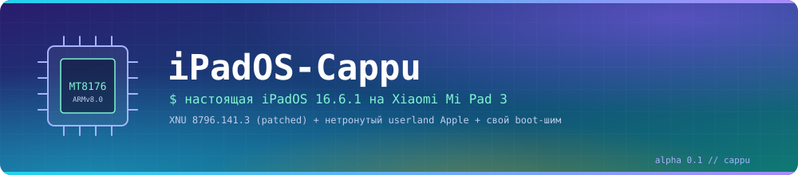
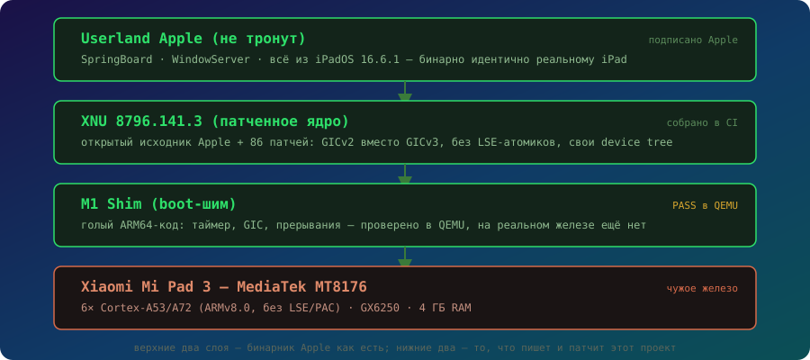

<picture>
  <source media="(prefers-color-scheme: dark)" srcset="assets/banner-dark.svg">
  <source media="(prefers-color-scheme: light)" srcset="assets/banner-light.svg">
  
</picture>

<div align="center">

[](criticalKeepAnythingNotNeededOutOfHere/docs.md)
[](LICENSE)
[-999)](research/j171ap.adt)
[-44aa44)](criticalKeepAnythingNotNeededOutOfHere/docs.md)
[](https://github.com/apple-oss-distributions/xnu)
[](patches/)

</div>

---

Проект по запуску **iPadOS 16.6.1** на **Xiaomi Mi Pad 3** (cappu, MediaTek MT8176: 4x Cortex-A53 + 2x A72, ARMv8.0, PowerVR GX6250, 4 ГБ RAM).

Подход: открытое ядро **XNU 8796** с патчами под MT8176, свой загрузочный шим и **нетронутый userland Apple** из IPSW iPad 7 (iPad7,11, 20G81). Это не джейлбрейк и не Android с темой.

**Статус: Alpha.** Подготовка без железа, на планшете ничего ещё не запускалось.

| Компонент | Статус |
| --- | :---: |
| Device tree iPad7,11 из реальной IPSW | ✅ |
| Шим M1 в QEMU (Cortex-A72, GICv2), `RESULT: PASS` | ✅ |
| Формат boot-образа (по трём TWRP), образы M1 в `dist/` | ✅ |
| Сборка XNU 8796 в GitHub Actions | ✅ |
| Патч GICv2 (0082) и ядро без LSE-атомиков (0083, 865 → 0) | ✅ |
| Ранняя консоль, тач FT5x46, UART0 (0084-0086) | 🟡 написаны, на железе не запускались |
| Драйвер eMMC (M2) | ⬜ |
| Корневая ФС из IPSW | ⬜ |
| Шим M1 на реальном планшете | ⬜ |
| GPU, Wi-Fi, звук | ⬜ |

✅ проверено · 🟡 написано, не проверено на железе · ⬜ не начато

<picture>
  <source media="(prefers-color-scheme: dark)" srcset="assets/architecture-dark.svg">
  <source media="(prefers-color-scheme: light)" srcset="assets/architecture-light.svg">
  
</picture>

## Безопасность

Никогда не пишем в preloader/lk. Ставим только в `userdata` (Android-данные стираются). Boot-образы только через `fastboot boot` (RAM, ничего не прошивает), никогда `fastboot flash`. Перед любой записью бэкап нужных разделов. Подробности: [документация](criticalKeepAnythingNotNeededOutOfHere/docs.md), раздел 6.

## Запуск

```
python cappu.py                 # меню
python cappu.py doctor          # какие инструменты есть
python cappu.py qemu            # собрать шим M1 и прогнать в QEMU
python cappu.py image --ref twrp.img   # собрать образы M1 (dist/)
python cappu.py report          # данные о планшете, только чтение
python cappu.py tablet          # пошаговый fastboot boot, ничего не прошивает
python cappu.py fetch           # скачать последнее ядро из Actions + проверка LSE
```

Нужны Python 3 и LLVM (`clang`, `ld.lld`, `llvm-objcopy`); для `qemu` ещё `qemu-system-aarch64`; для `tablet` `adb` и `fastboot`.

## Структура

```
patches/     патчи XNU 8796 (86 шт., 0082-0086 под MT8176)
shim/        диагностический boot-шим M1 (MT8176)
tools/       генератор device tree, сборка boot-образов, сканер LSE, ipsw_fetch.py
research/    device tree iPad7,11 и данные из IPSW
dist/        готовые образы M1 (только для fastboot boot)
criticalKeepAnythingNotNeededOutOfHere/docs.md   вся документация проекта
```

## Основа и лицензия

Подход и часть базы взяты из [dipa-studio/ios-sweet](https://github.com/dipa-studio/ios-sweet) (MIT); идея переписывать arm64e-userland на CPU без PAC из [ry-diffusion/Bergamota](https://github.com/ry-diffusion/Bergamota). Код и документация этого репозитория: [CC BY-NC 4.0](LICENSE) (личное использование, форки и учёба можно; продавать и выдавать за своё без указания автора нельзя).
